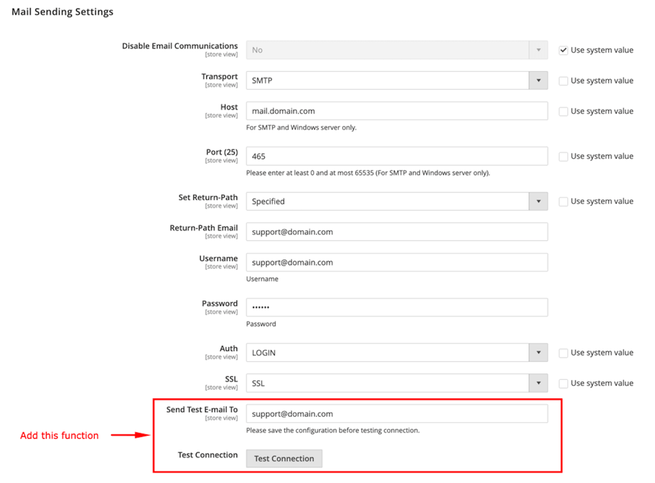

# Magento 2 SmtpTest

This module adds a **Test Connection** button to the following location in the Magento 2 Admin Panel:

**Stores > Configuration > Advanced > System > Mail Sending Settings**

This feature allows you to send a test email to a specified email address to verify that your email configuration is working correctly.

It also helps you troubleshoot email delivery issues and debug SMTP configuration problems.

## Screenshot



## How to use Magepow_SmtpTest extension

 #### Install via composer (recommend)
Run the following commands in Magento 2 root folder:
```
composer require magepow/smtptest
php bin/magento setup:upgrade
php bin/magento setup:static-content:deploy -f
php bin/magento c:f
```
